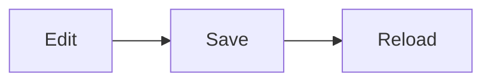

# presiterm

Markdown in, a WezTerm presentation out: real terminal text you can resize while you present,
diagrams and pictures as inline images, reload on save at the slide you edited. Pure Rust, the
only program it starts is `wezterm`.

## Install

Needs [WezTerm](https://wezterm.org).

```sh
cargo install --git https://github.com/mborejdo/presiterm presiterm
cargo install --path apps/presiterm                         # from a checkout
cargo install --path apps/presiterm --no-default-features   # no Typst: much smaller, faster build
```

Without Typst, typst fences are errors and tables are aligned text.

## Usage

```sh
presiterm new talk                     # talk/slides.md and an example diagram
presiterm --window talk/slides.md      # own WezTerm window, 58x20 cells at 42 pt
presiterm talk/slides.md               # in the WezTerm you are in
presiterm lint talk/slides.md          # does every slide fit, is every file there
presiterm ctl goto 5                   # drive a running presentation from another terminal
```

Keys: space, right, enter next step or slide; backspace, left back; `n` notes; `+`, `-`, `0`
font size; `12` enter jumps; `q` quits.

The manual is in the binary, sources in [docs/handbook/](docs/handbook/):

```sh
presiterm --help             # commands, examples, exit codes
presiterm handbook           # quickstart, keys, dialect, diagrams, window, config, tools, troubleshooting
presiterm handbook dialect   # one topic
presiterm tldr font size     # search it
```

## Slides

One file, split on `#`, `##` and `---`.

````markdown
---
title: My talk
author: Jane Doe
theme: dark            # or light
font-size: 48          # points
tags: long             # active tags for {only} blocks
---

# My talk

**A sentence that carries the talk**

---

# Three points

- shown at once
+ appears on the next key press
+ and this one on the one after

Note: only the presenter sees this (key n).

---

# Code and a table

```bash
cargo install --path apps/presiterm
```

| Key   | Does          |
|:------|:--------------|
| space | next step     |
| n     | speaker notes |

---

# A picture

{h=6}

:::{notes}
Longer notes go in a notes block.
:::

:::{only} long
This paragraph is only in the long version.
:::
````

- Each paragraph line stays a line. `==marked==` and `__marked__` are underlined.
- `{h=N}`, `{w=N}`: picture height and largest width in cells; without `h` it fills the slide.
- MyST colon fences: `notes`, `metrics`, `only`; others show their body. `{only} expr` and
  `:only: expr` keep content when `expr` (`and`, `or`, `not`, parentheses) holds for `tags:`.

## Diagrams

````markdown


{h=9}

```typst steps=3 h=6
#diagram(
  node((0, 0), [Markdown]), edge("-|>"),
  node((1, 0), [Slides]), edge("-|>"),
  node((2, 0), [Terminal]),
)
```
````

Mermaid (fence or `.mmd`) in the theme's colours; `steps` lights a node per key press,
`steps=a,b,c` picks which and in what order. `typst` fences using `diagram`, `node` or `edge` get
[fletcher](https://typst.app/universe/package/fletcher) (fetched once, cached) and the palette
tokens as colours. More: `presiterm handbook diagrams`.

## Film

`presiterm film` (up to 0.2.0) is [flipcard](https://github.com/mborejdo/flipcard) now:
`flipcard talk/slides.md`.

## Config

`presiterm.toml` next to the deck or above, or `~/.config/presiterm/config.toml`. Per key the
closest wins, a flag beats both.

```toml
font_size = 48
screen    = "1728x1117"   # what `presiterm lint` checks against
grid      = "58x20"       # the --window grid, columns x rows
logo      = "logo.svg"    # top left of every slide, relative to this file
fonts     = ["fonts"]     # extra font files or folders, relative to this file

[theme.dark]              # any design token, the rest keep their defaults
accent = "#ff8800"

[theme.fonts]
mono = "Fira Code"        # typst diagrams and tables; Inter and Fira Code are built in
display = "Inter"         # headings in a film of the deck (flipcard)
```

`presiterm config talk/slides.md` shows where each value comes from.

## How it works

- colonmark parses Markdown and colon fences (comrak), deckmark cuts slides of blocks.
- Text goes onto the window's cell grid as terminal text.
- Pictures and diagrams are drawn at their cells' pixel size, cached, sent as OSC 1337 images.
- A font size change is a WezTerm user variable; the slide is laid out again on the new grid.
- A 300 ms poll reloads the deck and jumps to the first changed line.

## Examples

`examples/intro` (the dialect), `diagrams` (mermaid, fletcher), `media` (a picture, light
theme): `presiterm --window examples/intro/slides.md`.

## Workspace

| crate | what |
|---|---|
| [`apps/presiterm`](apps/presiterm) | the binary: layout, pager, WezTerm glue, lint, config, manual |
| [`packages/colonmark`](packages/colonmark) | Markdown with MyST colon fences on comrak, as an owned tree; `{only}` |
| [`packages/deckmark`](packages/deckmark) | the deck dialect: slides, diagrams and pictures in the deck's tokens, the Typst faces |
| [`packages/swatchbook`](packages/swatchbook) | design tokens with a TOML overlay; Inter and Fira Code vendored |
| [`packages/typstkit`](packages/typstkit) | in-process Typst to PNG, SVG and PDF, vendored fonts, Typst Universe packages |
| [`xtask`](xtask) | `cargo xtask qa` and the other checks |

## Development

```sh
cargo xtask qa       # fmt-check, lint, test, doc, no-shellout
cargo xtask demo     # lint the example decks
```

More: [docs/development.md](docs/development.md), [docs/design.md](docs/design.md).

## License

[Apache-2.0](LICENSE-APACHE) or [MIT](LICENSE-MIT), at your option. The fonts in
`packages/swatchbook/fonts` are SIL OFL 1.1.
