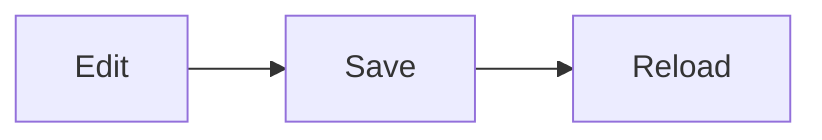

# presiterm

Markdown in, a presentation in a WezTerm window out.

The text on a slide is real terminal text in WezTerm's own font, so the font size is yours to
change while you present. Pictures and diagrams (mermaid, Typst with fletcher, tables) are drawn
in-process and shown as inline images. Save the Markdown file and the slide reloads, on the slide
you just edited. Pure Rust; the only program presiterm starts is `wezterm`.

## Install

You need [WezTerm](https://wezterm.org) and a Rust toolchain.

```sh
cargo install --git https://github.com/mborejdo/presiterm --branch v2 presiterm
# or from a checkout
cargo install --path apps/presiterm
```

The default build includes the Typst engine (a few minutes for a clean build). Without it:

```sh
cargo install --path apps/presiterm --no-default-features
```

That binary is much smaller; a typst fence becomes an error on the slide and tables are drawn as
aligned text.

## Usage

```sh
presiterm new talk                     # talk/slides.md and an example diagram
presiterm --window talk/slides.md      # a dedicated WezTerm window, 58x20 cells at 42 pt
presiterm talk/slides.md               # present in the WezTerm you are in
presiterm lint talk/slides.md          # does every slide fit, is every file there
presiterm ctl goto 5                   # drive a running presentation from another terminal
```

Keys: space, right or enter for the next step (a bullet, a lit diagram node) or slide; backspace
or left to go back; `n` for the speaker notes; `+`, `-` and `0` for the font size; `12` then enter
to jump; `q` to quit.

Everything else is in the manual that ships in the binary:

```sh
presiterm --help             # commands, examples, exit codes
presiterm handbook           # topics: quickstart, keys, dialect, diagrams, window, config, tools
presiterm handbook dialect   # one topic in full
presiterm tldr font size     # search the manual
```

The topics are the Markdown files in [docs/handbook/](docs/handbook/).

## Slide syntax

A deck is one Markdown file. Slides split on `#` and `##` headings and on `---` lines.

````markdown
---
title: My talk
author: Jane Doe
theme: dark            # or light
font-size: 48          # points
tags: long             # active tags for {only} blocks
---

# My talk

**A sentence that carries the talk**

---

# Three points

- shown at once
+ appears on the next key press
+ and this one on the one after

Note: only the presenter sees this (key n).

---

# Code and a table

```bash
cargo install --path apps/presiterm
```

| Key   | Does          |
|:------|:--------------|
| space | next step     |
| n     | speaker notes |

---

# A picture

{h=6}

::: notes
Longer notes go in a notes block.
:::

:::{only} long
This paragraph is only in the long version.
:::
````

- Every line of a paragraph stays its own line on the slide.
- Inline: `**bold**`, `*italic*`, `` `code` ``, `==marked==` and `__marked__` (underlined).
- `{h=N}` and `{w=N}` after a picture give its height and largest width in cells; without `h` it
  takes the rest of the slide.
- Colon fences in the MyST style (`:::{name} argument`, `:key: value` options) group content.
  `notes` and `only` are understood; any other directive shows its body. `:::{only} expr` and an
  `:only: expr` option keep content when `expr` (tags with `and`, `or`, `not`, parentheses) holds
  for the frontmatter's `tags:`.

## Diagrams

````markdown


{h=9}

```typst steps=3 h=6
#diagram(
  node((0, 0), [Markdown]), edge("-|>"),
  node((1, 0), [Slides]), edge("-|>"),
  node((2, 0), [Terminal]),
)
```
````

- Mermaid (fence or `.mmd` file) is drawn by mermaid-rs-renderer in the theme's colours. `steps`
  lights one node per key press; `steps=a,b,c` picks the nodes and their order.
- A `typst` fence is Typst source. Calls to `diagram`, `node` or `edge` import
  [fletcher](https://typst.app/universe/package/fletcher), downloaded from Typst Universe on first
  use and cached. The palette tokens (`ink`, `accent`, `ok`, ...) are Typst colours in the fence.

`presiterm handbook diagrams` has the details.

## Config

Settings you want every time go in `presiterm.toml` next to the deck (or in a folder above it), or
in `~/.config/presiterm/config.toml`. Per key, the closest file wins; a flag beats both.

```toml
font_size = 48
screen    = "1728x1117"   # what `presiterm lint` checks against
grid      = "58x20"       # the --window grid, columns x rows
logo      = "logo.svg"    # top left corner of every slide, relative to this file

[theme.dark]              # any design token; the rest keep their defaults
accent = "#ff8800"

[theme.fonts]
mono = "Fira Code"        # typst diagrams and tables; Inter and Fira Code are built in
```

`presiterm config talk/slides.md` shows which files apply and where each value comes from.

## Examples

`examples/` has three decks: `intro` (the dialect), `diagrams` (mermaid and fletcher) and `media`
(a picture on the light theme).

```sh
presiterm --window examples/intro/slides.md
```

## Workspace

| crate | what |
|---|---|
| [`apps/presiterm`](apps/presiterm) | the binary: layout, pager, WezTerm glue, lint, config, manual |
| [`crates/colonmark`](crates/colonmark) | Markdown with MyST colon-fence directives on comrak, as an owned tree; `{only}` conditions |
| [`crates/swatchbook`](crates/swatchbook) | design tokens (palettes, font families, sizes) with a TOML overlay; Inter and Fira Code vendored |
| [`crates/typstkit`](crates/typstkit) | in-process Typst to PNG, SVG and PDF with the vendored fonts and Typst Universe packages |
| [`xtask`](xtask) | `cargo xtask qa` and friends |

[docs/design.md](docs/design.md) explains the decisions, [docs/development.md](docs/development.md)
the checks and tests.

## License

Licensed under either of [Apache License, Version 2.0](LICENSE-APACHE) or [MIT license](LICENSE-MIT)
at your option. The fonts in `crates/swatchbook/fonts` are under the SIL Open Font License 1.1.
