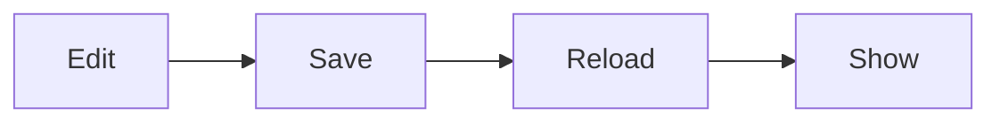

# Diagrams

Mermaid and Typst, drawn in-process

---

# A mermaid flow, one node per key press



Note: Each key press lights the next node.

---

# From a file

{h=9}

::: notes
A `.mmd` file is read next to the deck and reloads when it changes.
:::

---

# Typst with fletcher

```typst steps=3 h=6
#diagram(
  node((0, 0), [Markdown]),
  edge("-|>"),
  node((1, 0), [Slides]),
  edge("-|>"),
  node((2, 0), [Terminal]),
)
```

Note: steps=3 lights the three nodes in order.

---

# Colours from the theme

```typst h=5
#diagram(
  node((0, 0), [ok], fill: ok, stroke: none),
  edge("->"),
  node((1, 0), [warn], fill: warn, stroke: none),
  edge("->"),
  node((2, 0), [stop], fill: stop, stroke: none),
)
```
