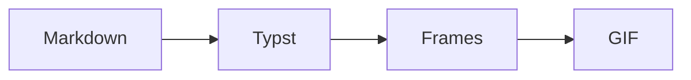

# The ==same deck==, now a film

**Markdown in, a GIF out**

---

# What a key press becomes

- a scene of the film
+ with a build-in of its own
+ and a hold after it

---

# Numbers count up

:::{metrics}
1 200 | cards rendered
60 % | smaller than video
:::

The palette is learned from the stills, only changed pixels are stored.

---

# A diagram lights up



---

# Code stays code

```rust
let frames = filmstrip::sequence(&scenes, timing)?;
let gif = filmstrip::gif::encode(&frames, &stills, 10, 48)?;
```

---

# Thanks

`presiterm film slides.md --mp4 --docx --pdf`

Note: The closing card. Notes never appear in the film.
